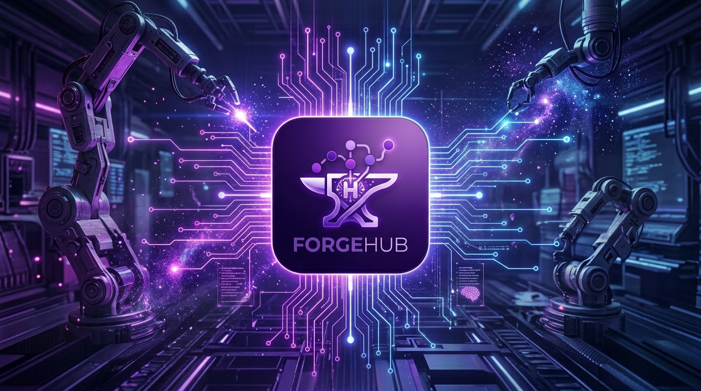

# ForgeHub



[](https://github.com/huchukato/ForgeHub/releases/latest)
[](https://github.com/huchukato/ForgeHub/releases)
[](#-download-desktop-app)
[](https://runpod.io)
[](#-frontend)

A desktop app for orchestrating ComfyUI workflows on **Runpod Serverless** endpoints — wildcard prompts, QwenVL prompt enhancer, job queue and output gallery. Backend bundled: nothing else to install.

Companion to the workers: [runpod-qwen21](https://github.com/huchukato/runpod-qwen21) (Qwen Image 2.1 T2I/Edit + Pony) · [runpod-minimax-h3](https://github.com/huchukato/runpod-minimax-h3) (MiniMax H3 video+audio) · [runpod-ltx-25](https://github.com/huchukato/runpod-ltx-25) (LTX 2.5 video+audio: I2VA/T2VA, FL2VA, pose loops)

It also ships built-in **RunPod Cloud** workflows — [RunPod Public Endpoints](https://docs.runpod.io/public-endpoints/reference) that run with just your API key, no endpoint to deploy, billed per use:

| Workflow | What it does | Price |
| --- | --- | --- |
| Nano Banana 2 Edit | Multi-image editing (up to 14 refs), up to 4K | $0.0875–0.175/img |
| Z-Image Turbo T2I | Fast 6B text-to-image | $0.005/img |
| Flux Schnell T2I | FLUX draft generation | $0.0024/MP |
| Flux Dev T2I | FLUX flagship quality | $0.02/MP |
| Seedream 4.0 T2I | ByteDance text-to-image | $0.027/img |
| Chatterbox Turbo TTS | Text-to-speech, 20 voices + voice clone | $0.001/s |
| Minimax Speech 02 HD | HD TTS with emotion control | $0.05/1K chars |

Prompt assist (Settings → LLM service) can also run on RunPod LLMs — **Qwen3 32B** and **Moonshot Kimi** — reusing the same API key.

## 📥 Download (desktop app)

Get the latest build from [Releases](https://github.com/huchukato/ForgeHub/releases/latest) — the backend is bundled, nothing else to install:

| Platform | File |
| --- | --- |
| macOS (Apple Silicon) | `ForgeHub-*-arm64.dmg` |
| Windows | `ForgeHub.Setup.*.exe` |
| Linux | `ForgeHub-*.AppImage` · `forgehub-app_*_amd64.deb` |

Unsigned builds — how to open them:

- **macOS**: run `xattr -dr com.apple.quarantine /Applications/ForgeHub.app` (or right-click → Open), or install [Sentinel](https://github.com/alienator88/Sentinel-App) — `brew install --cask sentinel` — and drop the app on "Allow unsigned app to launch".
- **Windows**: click "More info → Run anyway".

Then set your Runpod API key in **Settings** — "Detect from account" lists your endpoints automatically.

## ⚡ Quick start (from source)

**macOS / Linux**

```bash
git clone https://github.com/huchukato/ForgeHub.git && cd ForgeHub
./start.sh
```

**Windows**

```bat
git clone https://github.com/huchukato/ForgeHub.git && cd ForgeHub
start.bat
```

The script handles everything: installs **uv** if missing, creates `.venv` and installs the backend (`pip install -e .`), runs `npm install` + frontend build, then starts on **http://127.0.0.1:8484**. On first run it copies `.env.example` → `.env`: fill it in (Runpod API key + endpoint id) and relaunch.

Options: `./start.sh --build` forces a frontend rebuild · `./start.sh --dev` starts backend + Vite dev server (:5173, hot reload).

Prerequisites: only **Node.js** (for the frontend build) — everything else is handled by uv.

## ☁️ Execution

Jobs always run on a RunPod serverless endpoint: `/run` → `/status` poll → base64 output saved to `data/storage` and served from `/outputs/`. Set your API key + endpoint in Settings (or `.env`) — "Detect from account" lists your endpoints automatically.

Wildcard expansion (`__pmp/…__`, `__mmh3/…__`, `__ltx/…__`) and runtime selects happen backend-side — the `wildcards/` directory is bundled; override with `FORGEHUB_WILDCARD_DIRS` (colon-separated).

The jobs bar shows the elapsed time plus an estimated cost (`~$X.XXX`) computed from the endpoint's GPU hourly rate.

## 🔧 Environment variables

- `FORGEHUB_HOST` / `FORGEHUB_PORT` — backend bind (default `0.0.0.0:8484`)
- `RUNPOD_API_KEY` / `RUNPOD_ENDPOINT_ID` — serverless endpoint
- `FORGEHUB_STORAGE_DIR` — output/upload storage (default `data/storage`)
- `FORGEHUB_WILDCARD_DIRS` — wildcard dirs (default `./wildcards`)
- `FORGEHUB_CHAT_LLM_URL` / `FORGEHUB_CHAT_LLM_MODEL` / `FORGEHUB_CHAT_LLM_KEY` — optional prompt assist (OpenAI-compatible)
- `FORGEHUB_CHAT_BASE_URL` — optional QwenVL-Mod `/qwenvl/chat` endpoint
- `FORGEHUB_FRONTEND_DIR` — frontend dist served from `/`

See `.env.example` for the full set.

## 🖥️ Frontend

```bash
cd forgehub-app
npm run dev            # Vite dev server
npm run build          # production build (served by the backend)
npm run electron:dev   # Electron desktop in dev
npm run electron:build # dmg/exe via electron-builder
```

The packaged desktop app spawns its own bundled backend on `127.0.0.1:8484` — nothing to configure. In `electron:dev` it loads the Vite dev server, so start the backend too (e.g. `./start.sh`).

## 🧩 Workflows

JSON files in ComfyUI **API format** (`Export API`), with an optional `.meta.json` for metadata/parameters:

```json
{
  "id": "pony-txt2img",
  "name": "Pony XL Txt2Img",
  "category": "image",
  "description": "Generate images with Pony Diffusion XL",
  "tags": ["pony", "sdxl"],
  "parameters": [],
  "outputs": ["image"]
}
```

Categories: free-form — use model names so the sidebar groups sensibly (e.g. `LTX 2.5`, `MiniMax H3`, `Qwen Image 2.1`, `Pony`, `RunPod Cloud`). Groups are collapsible in the sidebar.

### RunPod Public Endpoints

A meta can point at any [RunPod Public Endpoint](https://docs.runpod.io/public-endpoints/reference) — no dedicated endpoint, no ComfyUI graph, per-use billing on your RunPod account:

```json
{
  "id": "nanobanana2-edit",
  "name": "Nano Banana 2 Edit",
  "category": "RunPod Cloud",
  "endpoint_id": "google-nano-banana-2-edit",
  "public_endpoint": true,
  "outputs": ["image"],
  "parameters": [
    { "key": "prompt", "label": "Edit instruction", "type": "text", "target": "job" },
    { "key": "images", "type": "images", "target": "job", "max": 14 },
    { "key": "resolution", "type": "select", "target": "job",
      "default": "1k", "options": ["1k", "2k", "4k"] }
  ]
}
```

- `public_endpoint: true` — the workflow `.json` is just `{}`; every `target: "job"` parameter is sent 1:1 in the job `input`, empty values are dropped, and `images` go base64.
- The job output is normalized from the endpoint's shape (`output.result`, `output.image_url`, `output.audio_url` — URL or base64) and `output.cost` is shown as the real job price.
- Bundled PE workflows: **Nano Banana 2 Edit**, **Z-Image Turbo**, **Flux Schnell**, **Flux Dev**, **Seedream 4.0** (image), **Chatterbox Turbo**, **Minimax Speech 02 HD** (audio).
- Chat/prompt-assist can also run on RunPod LLMs — Settings → Prompt Assist → *RunPod · Qwen3 32B* or *RunPod · Moonshot Kimi* reuses your RunPod API key automatically.
